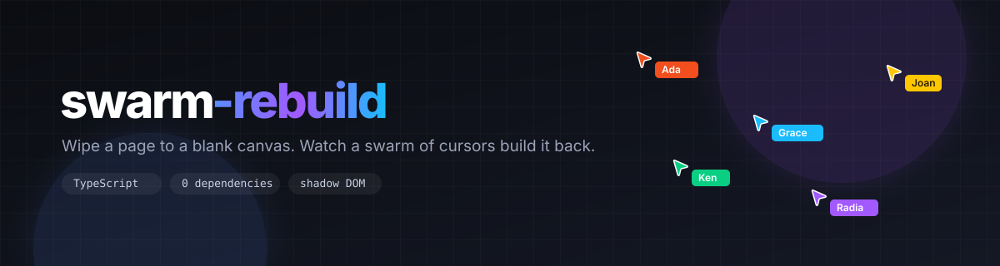
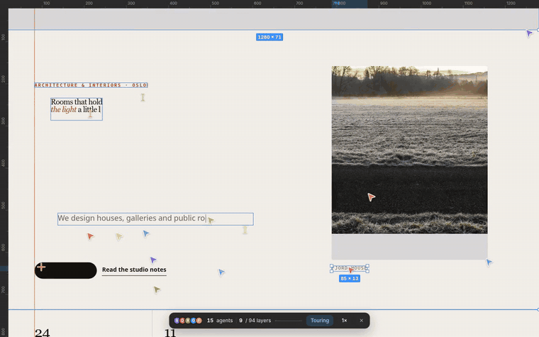
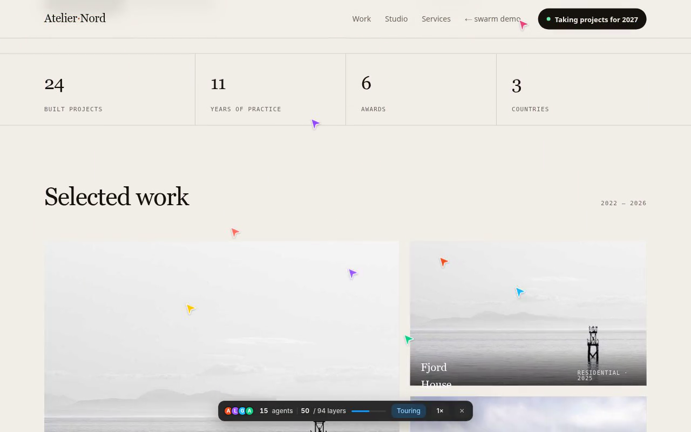

<div align="center">



<br>

**Wipe a page to a blank canvas. Watch a swarm of cursors build it back.**

[](https://www.typescriptlang.org/)
[](dist)
[](#)
[](LICENSE)
[](https://github.com/MaximeBoulle/Swarm-Rebuild/actions/workflows/ci.yml)

[Live demo](https://maximeboulle.github.io/Swarm-Rebuild/demo/) · [Quick start](#quick-start) · [How it works](#how-it-works) · [API](#api)

</div>

---



<p align="center">
  <a href="media/demo.mp4"><b>▶ Watch the full-quality video</b></a>
  &nbsp;·&nbsp;
  <a href="demo/showcase.html">Open the showcase</a>
  &nbsp;·&nbsp;
  <a href="demo/complex.html">Stress fixture</a>
</p>

---

## What it does

A real page, rebuilt in front of the visitor by a flock of fake multiplayer
cursors. Crosshair-dragged boxes, typed text, pen-tool lines, ruler guides and
media that fades in — then the overlay disappears and the real DOM takes over.

It is not a video, not a canvas recording, and not a screenshot. The engine
walks the live DOM once, turns it into a blueprint, then rebuilds it with real
nodes inside a shadow root. That is why the text reflows, the fonts match and
the page stays scrollable the whole time.

```ts
import { createSwarm } from "swarm-rebuild";

createSwarm({ trigger: "load", autoScroll: true });
```

---

## Quick start

```bash
npm install swarm-rebuild
```

<details open>
<summary><b>Whole page, on load</b></summary>

```ts
import { createSwarm } from "swarm-rebuild";

createSwarm({
  trigger: "load",
  autoScroll: true,
  speed: 1.4,
  onComplete: () => document.body.classList.add("swarm-done"),
});
```

</details>

<details>
<summary><b>When a section scrolls into view</b></summary>

```ts
createSwarm({
  trigger: "visible",
  target: "#hero",
});
```

</details>

<details>
<summary><b>Manual control</b></summary>

```ts
const swarm = createSwarm();

document.querySelector("#replay")?.addEventListener("click", () => swarm.replay());
document.querySelector("#stop")?.addEventListener("click", () => swarm.stop());
```

</details>

<details>
<summary><b>Plain script tag</b></summary>

```html
<script type="module">
  import { createSwarm } from "/node_modules/swarm-rebuild/dist/index.js";
  createSwarm({ trigger: "load" });
</script>
```

</details>

---

## Why it feels right

|                       |                                                                                                     |
| --------------------- | --------------------------------------------------------------------------------------------------- |
| **Shadow DOM**        | The overlay lives in its own root. Your CSS cannot leak in, the engine's CSS cannot leak out.       |
| **Real DOM**          | Text is rebuilt as text, not as pixels. It wraps, selects and scales exactly like the original.     |
| **One frame loop**    | Every cursor, task and layer is driven by a single `requestAnimationFrame` tick. No timers to leak. |
| **Scroll-aware**      | Tasks unlock top-down as the visitor scrolls, or let `autoScroll` drive the camera for you.         |
| **Bails out cleanly** | `Esc`, the HUD button, or `stop()` removes the overlay and hands the page back, untouched.          |
| **Typed end to end**  | Every item, task, agent and overlay primitive has a named type. No `any` in the codebase.           |

---

## How it works



<br>

**1. Snapshot** — the live DOM is walked once, including open shadow roots.

| Captured as | From                                                                |
| ----------- | ------------------------------------------------------------------- |
| Boxes       | fills, borders, radii, shadows, gradients, backdrop blur            |
| Text        | blocks cloned with their computed styles, links, inline code, icons |
| Lines       | single-side borders, `<hr>`                                         |
| Media       | ``, `<svg>`, `<video>`, `<canvas>`, iframes                    |
| Duplicates  | repeated siblings: nav links, cards, list rows, logos               |
| Guides      | shared left edges and baselines that text snaps to                  |

**2. Blank** — a full-viewport layer covers the page with its own background.
A hidden scroll pass first triggers lazy images and reveal-on-scroll content.

**3. Rebuild** — each cursor runs a small generator script per task. Tasks unlock
top-down; children wait for their parent box, duplicates wait for their master.
Rects are crosshair-dragged, text is typed with a caret, media sweeps in.

**4. Hand off** — the overlay fades out and the real page becomes interactive.

---

## API

### `createSwarm(options?): Swarm`

| Option       | Type                              | Default           |                                    |
| ------------ | --------------------------------- | ----------------- | ---------------------------------- |
| `trigger`    | `"manual" \| "load" \| "visible"` | `"manual"`        | When the effect starts             |
| `target`     | `Element \| string`               | `documentElement` | Anchor observed by `"visible"`     |
| `autoScroll` | `boolean`                         | `false`           | Let the swarm travel down the page |
| `speed`      | `number`                          | `1`               | Build speed multiplier             |
| `onComplete` | `() => void`                      | —                 | Every layer rebuilt                |
| `onDestroy`  | `() => void`                      | —                 | Overlay removed                    |

### Instance

| Member      |                                     |
| ----------- | ----------------------------------- |
| `start()`   | Run the effect. No-op while running |
| `stop()`    | Remove the overlay immediately      |
| `replay()`  | Tear down and rebuild from scratch  |
| `destroy()` | Stop and release the instance       |
| `running`   | `true` while the swarm is building  |

---

## Project layout

```
src/
  index.ts            public API, trigger handling
  core/
    app.ts            lifecycle, frame loop, HUD, scroll sync
    engine.ts         cursor agents, task graph, choreography
    view.ts           shadow root, layers, rendering
    snapshot.ts       DOM -> blueprint
    clone.ts          computed styles, pseudo-elements, SVG refs
    text.ts           text runs, reveal slicing
    env.ts            scroll container detection
    model.ts          Item, Task, Agent, Group, Model
    geometry.ts       bounds, unions, underline, spacing
    constants.ts      palette, cursor shapes, property lists
    utils.ts          easing, colour helpers
    style.ts          injected stylesheet
demo/
  index.html          library landing page, with live controls
  showcase.html       editorial studio site: photos, serif type, full layout
  complex.html        stress fixture: sticky header, cards, table, form
scripts/
  api-report.mjs      public API report, built on the TypeScript 7 native API
  serve.mjs           static server used by the e2e suite
tests/
  rebuild.spec.ts     Playwright: rebuild, hand-off, reduced motion, Esc
media/
  banner.svg  demo.gif  demo.mp4  poster.png
.github/
  workflows/ci.yml  workflows/release.yml  workflows/pages.yml
```

---

## Development

Requires **Node 26+** and **npm 11+**.

```bash
npm install
npm run dev             # tsup in watch mode
npm run typecheck       # tsc --noEmit
npm run build           # tsup + declaration emit
npm run api-report      # regenerate api-report.md
npm run api-report:check # fail if the public API drifted
npm run demo            # vite demo
npm run test:e2e        # Playwright suite
npm run format          # prettier
```

Git hooks are managed by [Lefthook](https://lefthook.dev) and installed by
`npm install`: Prettier and the API report run on commit, typecheck and the API
report check run on push. Force a run with `npx lefthook run pre-push`.

| Output            |                 |
| ----------------- | --------------- |
| `dist/index.js`   | ESM bundle      |
| `dist/index.cjs`  | CommonJS bundle |
| `dist/index.d.ts` | Public types    |

### Why `tsc` emits the declarations

TypeScript 7 ships the native compiler. Its package root only exposes version
metadata; the programmatic API moved to `typescript/unstable/sync` — the new
Corsa API — which is still incomplete for emit: `Emitter` can print nodes, not
produce `.d.ts` files. Bundlers that wrap the old Strada API
(`rollup-plugin-dts`, `@rollup/plugin-typescript`, `tsup --dts`) cannot run on
TypeScript 7 yet.

So the pipeline splits the work: `tsc` emits declarations natively, esbuild
(through tsup) bundles the JavaScript. No compiler API involved.

### Public API report

`api-report.md` is generated from `src/index.ts` with the new TypeScript 7
native API (`typescript/unstable/sync`): open the project, take a snapshot,
read the entry program through the checker and print signatures with the
emitter. CI fails when the committed report drifts, so any public API change
shows up in the diff.

### Releases

Push a tag and the release workflow publishes to npm with provenance:

```bash
npm version minor
git push --follow-tags
```

#### First publish

npm only exposes the trusted-publisher settings once the package exists, so the
very first version is published by hand:

```bash
npm login
npm publish --access public
```

Then open **npmjs.com → Packages → swarm-rebuild → Settings → Trusted
publishing**, add a GitHub Actions publisher and tick **Allow npm publish**
(configurations created after September 2026 default to `npm stage publish`
only). The configuration expires if it is not used for a successful publish
within two days, so tag a release right after saving it.

From that point on, no token is needed: `release.yml` uses OIDC, and provenance
is generated automatically.

CI, Pages and Dependabot are already wired.

---

## Browser support

Chrome, Edge, Firefox and Safari, current versions. Requires Shadow DOM v1 and
`IntersectionObserver`. `backdrop-filter` is used only when the page already
uses it, and degrades silently.

---

## Limitations

- **Fixed and sticky elements** scroll away with the page during the rebuild.
- **Canvas, playing video and cross-origin iframes** cannot be cloned. They fall
  back to a grey placeholder unless the host supplies a screenshot.
- **Very long pages** are capped at 40 000 px of world height and 4 000 items.
- **Animations freeze** at the moment the snapshot is taken.
- **Web components** are rebuilt as plain styled elements; their state is not replayed.

---

## Credits

- **Joel Califa** — [Swarm](https://califa.github.io/swarm-site/), the original
  self-building site. The cursor set, the swarm physics and the build
  choreography are his design.

---

<div align="center">

**MIT** · built by [Maxime Boulle](https://github.com/MaximeBoulle)

</div>
